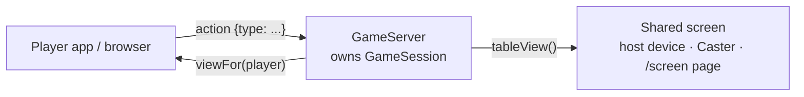

# Adding a game

This guide walks through adding a new game to Nico in the Box, end to end, and lists the tests a game needs before
its pull request can be merged. It's written for human contributors and AI coding assistants alike. Follow the
steps in order and use the checklist at the end.

Tic Tac Toe (`tictactoe`) is the smallest complete example. Color Clash (`colorclash`) shows private hands, compact
player views and a random deck. Copy from them freely.

**Quick start:** generate every piece at once, then replace the placeholder rules with yours.

```bash
dart run tool/new_game.dart dicewar "Dice War" 2 6
```

This creates the engine, player view, Flutter table, browser table and both test files, registers the game in all
three lists, adds it to the code map and bumps `kProtocolVersion`. The placeholder game ("take turns adding 1 or 2,
first to 10 wins") follows every rule in this guide and passes every check, so you start from green and change one
piece at a time. The sections below explain what each generated piece is for.

---

## 1. How a game fits in

The **host app is the referee.** It runs the only copy of your game logic. Players, browsers and shared screens are
just views that send moves and draw what the server sends back.



**A game has six pieces:**

| # | Piece | Where | Runs on |
|---|---|---|---|
| 1 | Engine: rules and state (`GameSession`) | `packages/nico_shared/lib/games/<id>/<id>_game.dart` | Host only (pure Dart) |
| 2 | Definition: name, player range, factory (`GameDefinition`) | same file | Host |
| 3 | Player view: what a player sees and taps | `packages/nico_shared/lib/games/<id>/<id>_view.dart` | Apps and browser client |
| 4 | Table: the shared-screen view in Flutter | the player view file, or `<id>_table.dart` when that gets big (as Color Clash does) | Host device as screen, Caster |
| 5 | Table: the shared-screen view in JavaScript | `assets/display/games/<id>.js` | Browser screen at `/screen` |
| 6 | Registration in three lists | `registry.dart`, `game_views.dart`, `assets/display/index.html` | everywhere |

**Nothing else changes.** The protocol, server, lobby, room sizing, shared screen, Caster and browser client all work
for any game that implements the pieces above. If you find yourself editing `game_server.dart` or `protocol.dart` to
add a game, stop and reconsider.

---

## 2. The engine (`GameSession`)

The engine is **pure Dart:** no Flutter imports and no networking. The interface is in
`packages/nico_shared/lib/games/game_session.dart`:

```dart
abstract class GameSession {
  void applyAction(String playerId, Json action); // validate + apply, or throw GameActionException
  Json viewFor(String playerId);                  // what this player may see
  Json tableView();                               // what EVERYONE may see (shared screen)
  bool get isOver;
  Json? get result;                               // {'winnerIds': [...], 'summary': '...'} once over
}
```

### Rules that every engine must follow

1. **The server trusts nothing.** `applyAction` must validate everything: that the sender plays in this game, whose
   turn it is, the action `type`, every field's type and range, and the game's own rules. When a move isn't allowed,
   throw `GameActionException('Short human-readable reason.')`. The player who sent it sees that message as a
   snackbar.
2. **Hide private information in `viewFor`.** A player's view must never contain another player's hand, secret roles
   or upcoming cards. The server sends the result of `viewFor` straight to that player's device, and a browser player
   can open the developer tools.
3. **`tableView()` contains public state only.** It goes to TVs and browsers anyone can look at. Build `viewFor` as
   `{...tableView(), <this player's private fields>}` so the two can't drift apart (see `ColorClashSession`).
4. **Views are plain JSON:** maps, lists, strings, numbers, bools and null. No objects, enums or `DateTime`. Return
   copies (`List.of(...)`), not internal lists.
5. **Randomness comes only from the injected `Random`.** Never call `Random()` or `DateTime.now()` inside the engine.
   That keeps games reproducible in tests: the same seed gives the same game.
6. **Use the `round` argument.** It starts at 0 and goes up by one on every *Restart game*. Use it to alternate who
   starts (Tic Tac Toe swaps X and O; Color Clash rotates the first player).
7. **Players arrive in join order.** Usually the host comes first. When the host's device is the shared screen, the
   host isn't in the list at all. Never assume the host is a player.
8. **Make the outcome explicit.** Once the game ends, `isOver` is true and `result` returns
   `{'winnerIds': [...], 'summary': 'Ann wins!'}`. Use an empty `winnerIds` for a draw. After that, every action
   must throw.
9. **Help the UI and bots with hints.** Putting `turn`, `winner` and lists of legal moves (Color Clash's `playable`,
   `canCallLast`) in the views makes the player widget and the test bots much simpler.

### Actions

An action is any JSON object with a `type`. Pick short verbs such as `{'type': 'place', 'cell': 4}` or
`{'type': 'play', 'cardId': 17, 'color': 'red'}`, and document them in a comment on your session class.

### Definition

```dart
const myGameDefinition = GameDefinition(
  id: 'mygame',                 // lowercase letters/digits; also the JS file name
  name: 'My Game',
  description: 'One line shown when picking a game.',
  minPlayers: 2,                // Start game is enabled from here
  maxPlayers: 6,                // decides the room size
  createSession: _create,
);

GameSession _create(List<PlayerInfo> players, int round, Random random) =>
    MyGameSession(players, round: round, random: random);
```

Also add a `MyGameSession.custom(...)` constructor that builds an exact state, like `ColorClashSession.custom`.
Tests depend on it.

---

## 3. The player view (Flutter)

This is a `StatelessWidget` that takes a `GameViewContext` (`packages/nico_shared/lib/games/game_views.dart`):

| Field | Meaning |
|---|---|
| `view` | This player's `viewFor` JSON |
| `myId` | This player's id |
| `lobby` | Room info, including nicknames: use `ctx.nicknameOf(id)`, which gives "You" for yourself |
| `sendAction(Json)` | Sends a move. Don't wait for an answer; the next `view` arrives on its own |
| `compact` | **True while a shared screen shows the table** (see below) |

Guidelines:

- **Draw only from `view`.** Never keep game state in the widget. The server is the source of truth.
- **Disable moves the player can't make.** Use `turn` and your legal-move hints. The server still refuses bad moves
  if one slips through.
- **Support the compact view.** When `ctx.compact` is true, everyone is watching the shared screen, so show only a
  one-line status ("Your turn!" / "Waiting for Ann") plus this player's own inputs (hand, buttons). Hide the public
  table. If the board *is* the input, as in Tic Tac Toe, keep showing it.
- **Give interactive elements stable `ValueKey`s**, such as `ValueKey('hand-card-$id')` and
  `ValueKey('draw-button')`. Widget tests and the device test bots find elements by these keys.
- **It must work in the browser client too.** Use plain Flutter widgets and no plugins that lack web support (the
  CI browser test catches mistakes). Remember that long lists are built lazily: a card scrolled out of view doesn't
  exist until you scroll to it.

## 4. The shared-screen table (Flutter)

This is a `StatelessWidget` that takes a `TableContext` (`table` = your `tableView()`, `lobby`, `nicknameOf`).
It's used when the host's device is the screen and by the Caster app, often on a TV.

- **Make it read-only and big.** Scale it with the screen size; Color Clash uses
  `LayoutBuilder` and `scale = (shortestSide / 450).clamp(1.0, 2.5)`.
- **Scale real sizes** (font size, icon size, padding), **not `Transform.scale`.** A transform only changes how
  things are painted, not their layout size, so neighbouring widgets overlap. That bug happened once already.
- Show whose turn it is, the public state, and the names of the players.

## 5. The shared-screen table (browser JavaScript)

Create `assets/display/games/<id>.js` and add `<script src="games/<id>.js"></script>` to
`assets/display/index.html`:

```js
'use strict';
NicoDisplay.register('mygame', (table, lobby, { el, nameOf }) => {
  const status = table.turn ? `${nameOf(lobby, table.turn)}'s turn` : '';
  return el('div', { class: 'game' },
    el('div', { class: 'status' }, status),
    // ... draw table from tableView() JSON
  );
});
```

- `el(tag, attrs, ...children)` builds elements, and strings become text nodes. **Never use `innerHTML`.** Nicknames
  are user input, and a test fails if any display script contains `innerHTML`.
- Reuse the classes in `assets/display/style.css` (`game`, `status`, `chips`, `chip`, `log`, …). Add new ones with
  units like `vmin`/`rem`, so the page scales from a laptop to a TV.
- The page already handles connecting, reconnecting, the lobby and the result banner. You only draw the table.
- Mirror the Flutter table so all three screen types look alike.

## 6. Register it

1. Add your definition to `availableGames` in `packages/nico_shared/lib/games/registry.dart`. The order there is the
   order hosts see.
2. Add your player view and table to `gameViews` and `gameTables` in `game_views.dart`.
3. Add the `<script>` tag (step 5).
4. **Bump `kProtocolVersion`** in `packages/nico_shared/lib/net/protocol.dart`. Older app builds don't know the new
   game and would get stuck when it starts. A version bump makes them refuse the room with a clear "different app
   version" message instead.
5. **Rebuild the browser client** (`tool/build_web_client.ps1` or `.sh`). The host app carries a copy of it.

---

## 7. Tests (required)

Run all of them locally before opening a pull request. CI runs the same checks.

### 7.1 Registry consistency (automatic)

`test/games/registry_consistency_test.dart` checks every registered game. It verifies that:
- the id is unique and well-formed
- the player range makes sense
- the `gameViews` and `gameTables` entries exist
- the JS renderer exists, registers the right id and is loaded by `index.html`
- sessions can be created at both ends of the player range for several rounds, with JSON-encodable views

**You don't write this test.** It fails until all of step 6 is done.

### 7.2 Engine tests: `packages/nico_shared/test/games/<id>_test.dart`

This is the most important file. Use `MyGameSession.custom(...)` to set up exact situations. Cover:

| What | Example from Color Clash / Tic Tac Toe |
|---|---|
| **Setup** | hands dealt, correct first player, initial table |
| **`round` behaviour** | the first player rotates or marks swap on restart |
| **Every rule**, legal and illegal | each action card; playing a card that doesn't match is refused |
| **Rejections** | out of turn, unknown `type`, wrong field types, a non-player, any move after the game ended |
| **End of game** | a win and a draw (if possible), the exact `result` map, `turn` is null |
| **Edge cases** | empty deck reshuffles, two-player special cases (Reverse acts as Skip) |
| **Randomized full games** | bots that only pick legal moves (from your hints) play 20+ seeded games; every one must finish |
| **Privacy (mandatory if anything is hidden)** | at *every* move of the random games, `tableView()` contains no private data, and `viewFor(a)` contains none of player b's private data. See `never contains a card from any hand` in `color_clash_test.dart` |
| **View relationship** | every key in `tableView()` has the same value in `viewFor(p)` |

### 7.3 Widget tests: `packages/nico_shared/test/widgets/`

Render your widgets from a **real session's** views, not hand-written JSON, so the views and the widgets can't drift
apart. Add tests for:

- **Player view, full:** it renders without exceptions and shows the public table.
- **Player view, compact:** the public table is hidden, the status line and inputs remain, and tapping an input
  calls `sendAction` with the right action.
- **Table at TV size** (`tester.view.physicalSize = Size(1920, 1080)`): it renders without exceptions, shows names
  and counts, and **nothing overlaps.** Compare `tester.getRect(...)` of neighbouring elements; see
  `on a TV-sized screen the player chips never overlap`.
- **`SharedScreenView`** with a `DisplayState` for your game shows your table and the result banner.

### 7.4 Through the real server (recommended)

Add one test to `test/net/` that plays a full game with a `GameServer` and `GameClient`s over loopback sockets
(see `server_client_test.dart` and `display_feed_test.dart`). It catches JSON round-trip and turn-flow mistakes that
engine tests can't. When waiting for a client's state, wait on **every** client you read from; a guest's update can
arrive before the host's.

### 7.5 Bots and device tests (when you can)

- **Teach the LAN bot your game:** add a `_myGameMove(view, me)` function and a `case` for your id in
  `tool/bot/lan_bot_test.dart`. Without it, the bot sits idle in your game.
- **Run a real session**, for example the Windows host plus the bot, or the tablet:

```bash
flutter test integration_test/lan_play_test.dart -d windows --dart-define=ROLE=host
flutter test tool/bot/lan_bot_test.dart --dart-define=HOST=<host ip>
```

  `integration_test/lan_play_test.dart` plays only Tic Tac Toe and Color Clash. Extending it for your game is
  welcome but not required. Keep the host window visible: a minimized window stops drawing.

### 7.6 Commands

```bash
dart format lib test integration_test tool packages caster/lib caster/test web_client/lib web_client/test
flutter analyze
flutter test
(cd packages/nico_shared && flutter test)
(cd packages/nico_native && flutter test)
(cd caster && flutter test)
(cd web_client && flutter test)
```

On Windows, don't run `dart format .`: it can crash while walking the Caster's Android build folders.

---

## 8. Checklist

Copy this into your pull request description.

```markdown
- [ ] Engine in `packages/nico_shared/lib/games/<id>/<id>_game.dart`: pure Dart, injected Random, uses `round`
- [ ] Every move validated; refusals throw `GameActionException` with a readable message
- [ ] `tableView()` public only; `viewFor` = table view + own private data; plain JSON
- [ ] `result` = {winnerIds, summary}; all moves refused once over
- [ ] `MyGameSession.custom(...)` for tests
- [ ] Player view (full + compact), stable ValueKeys on inputs, works in the browser client
- [ ] Flutter table (scales with real sizes, no Transform.scale)
- [ ] JS renderer `assets/display/games/<id>.js` (no innerHTML) + <script> tag in index.html
- [ ] Registered in `availableGames`, `gameViews`, `gameTables`
- [ ] `kProtocolVersion` bumped; web client rebuilt
- [ ] Tests: engine (rules, rejections, end, random games, privacy), widgets (full, compact, TV-size table), registry check passes
- [ ] (Recommended) server round-trip test; bot move function; a real device session
```

## 9. Tips for AI coding assistants

- **Read before you write:** `game_session.dart`, `game_views.dart`, one complete game folder, and this guide.
- **Change only what the steps list.** Server, protocol messages, lobby and screens are game-agnostic.
- **Run the registry consistency test early.** Its failure messages tell you which piece is missing.
- **Don't weaken tests to make them pass.** If the privacy or overlap test fails, fix the game.
- **Follow the branch rules in the README:** branch, pull request, never commit to `main`.
