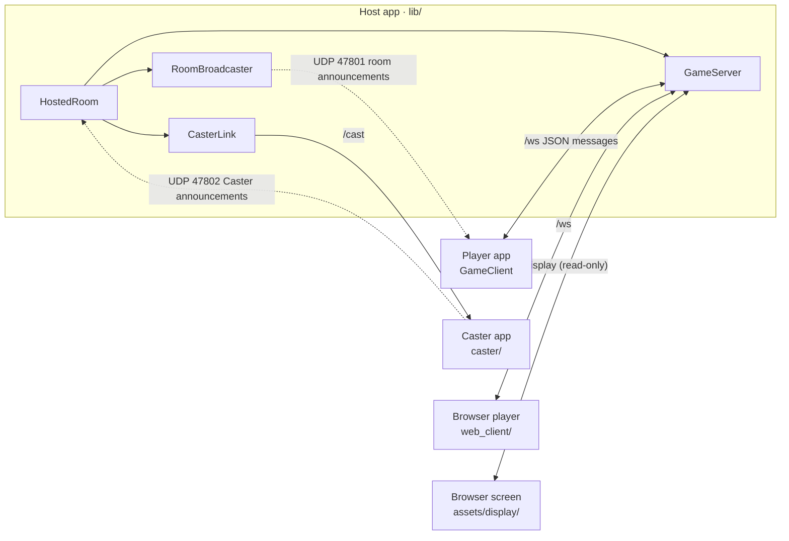

# Code map

A one-page orientation to the repository, so you can find the right files without reading everything.
`test/docs/code_map_test.dart` fails if a source file is missing here or a listed file no longer exists, so keep it
current when you add, move or delete files.

**Read next, depending on the task:** [ADDING_A_GAME.md](ADDING_A_GAME.md) to add a game; [PLAN.md](../PLAN.md)
for why things are the way they are; the [README](../README.md) for running, testing and the branch rules.

---

## 1. The big picture

- **The host is the referee.** `GameServer` owns the only `GameSession`. Clients send `action` messages and get back
  `viewFor(player)` (private). Shared screens get `tableView()` (public) inside `display` messages.
- **The host also plays,** through its own `GameClient` over loopback, identified by a secret `hostToken`. When the
  host's device *is* the shared screen, it takes no seat and receives `display` messages instead.
- **Packages:**
  - `nico_shared` is **web-safe** (no `dart:io`). It runs in the apps *and* the browser client.
  - `nico_native` is native-only LAN code (UDP).
  - The app, the Caster and the web client depend on them through `path:` dependencies.

---

## 2. Directory map

Lines are approximate, so you can tell big files from small ones.

### `lib/`: the host/join app (native only)

| File | Lines | What it does |
|---|---:|---|
| `lib/main.dart` | 29 | App entry and theme; opens `HomeScreen` |
| `lib/net/game_server.dart` | 466 | **`GameServer`**: rooms, messages, host-only commands, game sessions, display feed (`attachDisplay`, `displayState`). Routes `/ws` and `/display` here; plain HTTP goes to `web_routes.dart` |
| `lib/net/display_handle.dart` | 37 | `DisplayHandle`: one connected shared screen (part of `game_server.dart`, so it shares its private API) |
| `lib/net/player_seats.dart` | 189 | Seats (part of `game_server.dart`): hello and nicknames, resume tokens, the reconnect grace period, leaving, kicking, dropping connections |
| `lib/net/web_routes.dart` | 88 | `serveWebRequest`: plain HTTP routes `/`, `/play/`, `/screen/` (landing page, browser client, screen page) |
| `lib/net/hosted_room.dart` | 165 | **`HostedRoom`**: everything a host runs. Starts the server and broadcaster, joins as host, loads web assets, keeps the screen awake, manages the Caster (`connectCaster`) |
| `lib/net/caster_link.dart` | 140 | `CasterLink`: outbound connection to a Caster (`castHello` handshake, attaches it as a display, drop notice) |
| `lib/net/web_files.dart` | 65 | `WebFiles`/`MemoryWebFiles`: static files in memory (from a zip or assets), content types |
| `lib/net/web_pages.dart` | 75 | Small generated HTML pages: landing page, "not included" pages |
| `lib/net/display_frontend.dart` | 20 | `DisplayFrontend` interface + `HtmlDisplayFrontend` (serves `/screen/`) |
| `lib/net/multicast_lock.dart` | 18 | Android Wi-Fi multicast lock via MethodChannel (no-op elsewhere) |
| `lib/screens/home_screen.dart` | 67 | Host / Join buttons |
| `lib/screens/host_setup_screen.dart` | 150 | Nickname, room name, game, Single game screen settings → `HostedRoom.create` → `SessionScreen` |
| `lib/screens/join_screen.dart` | 237 | Room scan list + manual IP; nickname retry loop; `parseManualAddress` |
| `lib/widgets/join_info.dart` | 111 | Host lobby card: addresses, `/screen` URL, `/play` QR code, Windows firewall hint |
| `lib/widgets/caster_picker.dart` | 165 | Host lobby "Choose screen": Casters found, manual address, connected Caster |
| `android/app/src/main/kotlin/com/daanjacobs97/nico_in_the_box/MainActivity.kt` | 50 | Android side of the multicast lock |

### `packages/nico_shared/`: shared by every app (web-safe)

| File | Lines | What it does |
|---|---:|---|
| `packages/nico_shared/lib/net/protocol.dart` | 305 | **The protocol**: ports, `kProtocolVersion`, `Msg.*` message types, `ErrorCode`, `PlayerInfo`, `LobbyState`, `DisplaySettings`, `DisplayInfo`, `DisplayState`, `CasterAnnouncement` |
| `packages/nico_shared/lib/net/game_client.dart` | 281 | **`GameClient`** (ChangeNotifier): connect + hello, reconnects on its own after a drop (`reconnecting`), lobby/game/display state, notices, host commands, `DisconnectReason` |
| `packages/nico_shared/lib/net/channel/connect.dart` | 3 | Picks the WebSocket implementation (conditional import) |
| `packages/nico_shared/lib/net/channel/connect_io.dart` | 6 | Native WebSocket with 5 s pings (the only `dart:io` allowed in this package) |
| `packages/nico_shared/lib/net/channel/connect_web.dart` | 3 | Browser WebSocket |
| `packages/nico_shared/lib/games/game_session.dart` | 104 | **`GameSession`** interface, `GameDefinition` (+ `options`), `GameOption`, `GameOptions`, `GameActionException` |
| `packages/nico_shared/lib/games/registry.dart` | 14 | `availableGames`, `gameById` |
| `packages/nico_shared/lib/games/game_views.dart` | 45 | `GameViewContext` (+`compact`), `TableContext`, `gameViews` and `gameTables` maps |
| `packages/nico_shared/lib/games/tictactoe/tictactoe_game.dart` | 96 | Tic Tac Toe engine (marks swap per round) |
| `packages/nico_shared/lib/games/tictactoe/tictactoe_view.dart` | 170 | Tic Tac Toe player board + `TicTacToeTable` |
| `packages/nico_shared/lib/games/color_clash/clash_card.dart` | 80 | Cards, colors, `canPlayOn`, 108-card deck |
| `packages/nico_shared/lib/games/color_clash/color_clash_game.dart` | 324 | Color Clash engine (Uno-style rules, last-card catch, `custom` test constructor) |
| `packages/nico_shared/lib/games/color_clash/color_clash_view.dart` | 169 | Player view: hand, color picker, buttons (full/compact) |
| `packages/nico_shared/lib/games/color_clash/color_clash_table.dart` | 267 | Public table: `ClashTableArea` (in the full player view and on the shared screen), `ColorClashTable`, `ClashCardFace`, `colorOf` |
| `packages/nico_shared/lib/games/seasiege/seasiege_fleet.dart` | 132 | Sea Siege geometry: `ShipType`, `Ship` (+ `rotatedAround`, `nudgeToFit`, `fitsAmong`), `cellName` ("D4"), `isValidFleet`, `randomFleet` |
| `packages/nico_shared/lib/games/seasiege/seasiege_game.dart` | 250 | Sea Siege engine: placing (shuffle, move, ready) then battle; `shootAgain` option; free-for-all-ready (target per shot); numbered shot log (`n`); `custom` test constructor |
| `packages/nico_shared/lib/games/seasiege/seasiege_view.dart` | 344 | Sea Siege player view: placing (drag with preview, double-tap to turn, tap ship then square, Rotate, Shuffle, Ready; nudges to fit), then the enemy and own boards (stacked in portrait, side by side in landscape) with turn banner, target glow and shot toasts kept off the enemy board on your turn |
| `packages/nico_shared/lib/games/seasiege/sea_grid.dart` | 366 | `SeaGrid` (10×10 board used by both views: water, squares, ship sprites, shot markers, gold target glow, new-shot flash; whole-board tap, double-tap and drag, preview), `SeaWater` (the moving water under every board) |
| `packages/nico_shared/lib/games/seasiege/sea_effects.dart` | 307 | Turn and shot effects for both views: `seaTargetOf`, `TurnBanner` (gold, pulsing), `SeaShotFeed` (new shots only, 3 s each), `SeaToastLayer`, `SeaBoardPanel` (title, crosshair, dimming, toasts) |
| `packages/nico_shared/lib/games/seasiege/seasiege_sprites.dart` | 222 | `paintShip` (top-down art for each ship type, intact or wrecked; also exported as the browser PNGs), `ShipSprite` |
| `packages/nico_shared/lib/games/seasiege/seasiege_table.dart` | 152 | `SeaBoard`, `hostFirst`, `describeShot`, `SeaSiegeTable` (shared screen: "Ann is firing at Bob's fleet" banner, host's board first, side by side when wide, stacked when tall, toasts over the board hit) |
| `packages/nico_shared/lib/screens/session_screen.dart` | 298 | **`SessionScreen`**: lobby → game → result, notices, leaving, host-as-screen area, "Reconnecting…" banner; keeps the screen on while open |
| `packages/nico_shared/lib/screens/screen_awake.dart` | 28 | `ScreenAwake`: reference-counted wake lock while hosting or in a room (apps, and browsers where allowed) |
| `packages/nico_shared/lib/screens/lobby_view.dart` | 240 | Lobby: game, players (away ones marked), Single game screen settings (host), screen-lock tip (browsers), pinned Start button |
| `packages/nico_shared/lib/screens/shared_screen_view.dart` | 138 | `SharedScreenView`: draws a `DisplayState` (lobby / table / result) |
| `packages/nico_shared/lib/widgets/display_settings_editor.dart` | 103 | Single game screen switch + "where is the screen" choice (`ScreenChoice`) |
| `packages/nico_shared/lib/widgets/game_options_editor.dart` | 49 | Lobby game options: switches for the host, read-only rules for players |
| `packages/nico_shared/lib/widgets/host_controls.dart` | 134 | Host app-bar menu: restart, end, kick, close |
| `packages/nico_shared/lib/widgets/nickname_dialog.dart` | 66 | Nickname prompt with validation |
| `packages/nico_shared/lib/widgets/confirm_dialog.dart` | 27 | Yes/no dialog helper |
| `packages/nico_shared/lib/app/prefs.dart` | 21 | Remembered nickname (shared_preferences) |

### `packages/nico_native/`: native-only LAN code

| File | Lines | What it does |
|---|---:|---|
| `packages/nico_native/lib/discovery.dart` | 265 | Room announcements: `encodeAnnouncement`/`parseAnnouncement`, `RoomBroadcaster` (generic UDP announcer), `RoomScanner`, `localIPv4Addresses` |
| `packages/nico_native/lib/caster_scanner.dart` | 129 | `CasterScanner` + `DiscoveredCaster` (listens on UDP 47802) |

### `caster/`: Nico Caster app

| File | Lines | What it does |
|---|---:|---|
| `caster/lib/main.dart` | 149 | App: name (remembered), announcer, wakelock (turns freely); shows `IdleScreen` or `SharedScreenView` |
| `caster/lib/cast_server.dart` | 135 | `CastServer`: `/cast` WebSocket, one host at a time (`casterBusy`), display updates |
| `caster/lib/idle_screen.dart` | 127 | "Waiting for a host", rename dialog, address |

### `web_client/`: browser player client (Flutter web)

| File | Lines | What it does |
|---|---:|---|
| `web_client/lib/main.dart` | 152 | Joins the host that served the page (`Uri.base`) and reuses `SessionScreen` |

### `assets/display/`: browser shared screen (`/screen/`, HTML/JS)

| File | Lines | What it does |
|---|---:|---|
| `assets/display/index.html` | 22 | Page shell; loads `app.js` and one script per game |
| `assets/display/app.js` | 133 | `NicoDisplay`: `/display` WebSocket, reconnect, lobby/result, safe `el()` DOM helper, `register()` |
| `assets/display/style.css` | 253 | TV-scaled styles (incl. Sea Siege's portrait/landscape boards, moving water, turn banner, target glow, toasts and flash) |
| `assets/display/games/tictactoe.js` | 36 | Tic Tac Toe table renderer |
| `assets/display/games/colorclash.js` | 54 | Color Clash table renderer |
| `assets/display/games/seasiege.js` | 129 | Sea Siege table renderer (placing status, turn banner and target glow, host's board first, wrecks from `games/seasiege/*.png`, toasts and flash for new shots, remembered across redraws) |

### `tool/`: scripts

| File | What it does |
|---|---|
| `tool/check.ps1`, `tool/check.sh` | **Run before every PR**: format check, analyze, all five test suites (`-Fix`/`--fix` formats first) |
| `tool/new_game.dart`, `tool/new_game_templates.dart` | `dart run tool/new_game.dart <id> "<Name>" [min] [max]`: generates a placeholder game (all six pieces, tests, an example option, code map rows, protocol bump). Templates live in the part file |
| `tool/build_web_client.ps1`, `tool/build_web_client.sh` | Build `web_client/` into `assets/generated/web_client.zip` (git-ignored) |
| `tool/release/package_windows.ps1`, `tool/release/package_android.sh` | Build the release files into `build/release/`: Windows zips (with the Visual C++ runtime DLLs) and release-signed APKs (fails on a debug-signed APK) |
| `tool/bot/lan_bot_test.dart` | Scripted LAN player (all three games): `flutter test tool/bot/lan_bot_test.dart --dart-define=HOST=<ip>` |
| `tool/icons/draw_icons_test.dart` | Draws the app, Caster and browser-client icons into `icons/` (`flutter test tool/icons/draw_icons_test.dart`, then `dart run flutter_launcher_icons` in each app) |
| `tool/sprites/ship_sprites.dart`, `tool/sprites/draw_sprites_test.dart` | Export the Sea Siege ship sprites (`paintShip`) as PNGs into `assets/display/games/seasiege/` (`flutter test tool/sprites/draw_sprites_test.dart`); `test/games/seasiege_sprites_test.dart` fails while they're out of date |
| `tool/protocol_version.dart` | `check` / `set`: a PR into `main` must carry main's `kProtocolVersion` + 1; used by the PR workflow and the CI check (plain Dart, no Flutter) |

### `.github/`: CI and pull requests

| File | What it does |
|---|---|
| `.github/workflows/ci.yml` | CI on every PR: "Protocol version" check (main + 1), format, analyze, `dart:io` grep, all test suites, web client build + size budget, shared tests in Chrome |
| `.github/pull_request_template.md` | PR description sections: what and why, changes, checks, device tests |
| `.github/workflows/protocol_version.yml` | On every PR into `main`: sets `kProtocolVersion` to main's + 1, commits it to the PR branch as github-actions[bot] and starts CI on it (not for fork PRs) |
| `.github/workflows/release.yml` | On a `v*` tag: checks it matches `pubspec.yaml`, runs the packaging scripts, drafts a GitHub Release with the changelog section |
| `.github/release_install_notes.md` | Install instructions appended to every release |

---

## 3. Where to change what

| Task | Files |
|---|---|
| Add a game | `dart run tool/new_game.dart <id> "<Name>"`, then [ADDING_A_GAME.md](ADDING_A_GAME.md) (engine + views in `packages/nico_shared/lib/games/<id>/`, `assets/display/games/<id>.js`, three registrations) |
| Change a game's rules | `packages/nico_shared/lib/games/<id>/<id>_game.dart` + its test |
| Rules the host can switch (game options) | the game's `GameDefinition.options` + read them in its `createSession`; the lobby UI, server and screens handle the rest ([ADDING_A_GAME.md](ADDING_A_GAME.md)) |
| Add or change a network message | `protocol.dart` (`Msg`; `kProtocolVersion` is set on the PR automatically) → `game_server.dart` (handle/send) → `game_client.dart` (receive/expose) |
| New host-only command | `protocol.dart` (`Msg`), `game_server.dart` (`hostCommands` + handler), `game_client.dart` (method), `host_controls.dart` or `lobby_view.dart` (button) |
| Lobby UI | `lobby_view.dart`; host-only native extras arrive through `hostFooter` / `hostScreenControls` from `host_setup_screen.dart` |
| Shared screen behaviour | server: `displayState`/`_broadcastDisplay` in `game_server.dart`; Flutter: `shared_screen_view.dart`; browser: `assets/display/app.js` |
| Room discovery | `nico_native/lib/discovery.dart` (+ `join_screen.dart` UI) |
| Caster protocol | `protocol.dart` (`kCast*`, `castHello`), `caster/lib/cast_server.dart`, `lib/net/caster_link.dart` |
| Web routes / served files | `web_routes.dart`, `web_files.dart`, `web_pages.dart` |
| What the host app bundles | `pubspec.yaml` `assets:` (`assets/generated/`, `assets/display/`) |

## 4. Protocol cheat sheet

| Port | Use |
|---|---|
| TCP 47800 | `/ws` players · `/display` screens (read-only) · `/` landing · `/play/` browser client · `/screen/` screen page |
| UDP 47801 | Room announcements (`nicobox`) |
| UDP 47802 | Caster announcements (`nicobox-caster`) |
| TCP 47803 | Caster `/cast` |

**Messages:** every message is JSON with a `type`.
- **Client → server:** `hello` (with `nickname`, `protocol`, optional `hostToken`, `client: app|web`; or `resume`
  with a token to take back a kept seat), `action`, and `leave` (on purpose: frees the seat at once).
- **Host only:** `start`, `restart`, `endGame`, `kick`, `changeGame`, `closeRoom`, `setDisplay`, `setGameOptions`
  (lobby only; the values travel in `lobby.options`, and `display` adds `gameName` plus `rules` as text).
- **Server → client:** `welcome` (players also get a secret `resumeToken` and `graceMs`), `lobby` (players
  carry `away` while reconnecting), `gameState`, `gameOver`, `notice`, `error`, `kicked`, `closed`, and `display`
  (to screens).
- **Host → Caster:** `castHello`, answered by `castWelcome` or `error{casterBusy}`.

## 5. Tests: what lives where

| Suite | Run from | Covers |
|---|---|---|
| `test/` (app) | repo root | server and client over real loopback sockets (`net/server_client_test.dart`), reconnects (`net/reconnect_test.dart` on the server, `net/reconnect_client_test.dart` for the client and its banner), display feed (`net/display_feed_test.dart`), web routes (`net/web_routes_test.dart`), Caster link (`net/caster_link_test.dart`), hosted room (`net/hosted_room_test.dart`), game options over the wire (`net/game_options_test.dart`), home/dialog widgets (`widget_test.dart`), game registry (`games/registry_consistency_test.dart`), Sea Siege sprite PNGs up to date (`games/seasiege_sprites_test.dart`), protocol version rule incl. a real-git replay of two branches bumping to the same number (`test/tool/protocol_version_test.dart`), this map (`docs/code_map_test.dart`) |
| `packages/nico_shared/test/` | that folder | engines (`games/tictactoe_test.dart`, `games/color_clash_test.dart`, incl. privacy), protocol (`net/protocol_test.dart`), game options and their editor (`games/game_options_test.dart`), shared screens (`widgets/shared_screen_test.dart`), Sea Siege (`games/seasiege_test.dart`, `widgets/seasiege_view_test.dart`). Also runs in Chrome in CI |
| `packages/nico_native/test/` | that folder | `discovery_test.dart`, `caster_scanner_test.dart` |
| `caster/test/` | that folder | `cast_server_test.dart`, `idle_screen_test.dart` |
| `web_client/test/` | that folder | `web_join_test.dart` |
| `integration_test/lan_play_test.dart` | repo root, on devices | Real app on two devices (options: `ROLE`, `SCREEN`, `GAMES` (`all`, `ttt`, `sea`), `JOIN_IP`, `EXPECT_WEB_PLAYER`) |

## 6. Folders to skip

These are big, generated or irrelevant to most tasks. Don't read them unless the task is specifically about them:
- `android/`, `ios/`, `windows/` and the same folders under `caster/` and `web_client/` (Flutter platform scaffolding;
  the only hand-edited file is `MainActivity.kt` above, plus manifests and Info.plist for permissions)
- `build/`, `.dart_tool/`, `assets/generated/` (build output)
- `pubspec.lock` files (generated)
- `web_client/web/` (Flutter web shell: index.html, icons, manifest)

## 7. Gotchas

- **`packages/nico_shared` must not import `dart:io`**, because it runs in browsers. CI greps for this. A web build
  does *not* catch it (it only fails at runtime).
- **Never edit `kProtocolVersion` by hand.** Every PR into `main` gets main's version + 1 from the "Set protocol
  version" workflow (a bot commit on the PR branch: `git pull` before pushing again), and the "Protocol version" CI
  check enforces it. Builds from different merges then refuse each other cleanly.
- **Rebuild the browser client** (`tool/build_web_client`) after changing `web_client/` or `nico_shared`. The host
  app serves its own copy.
- **Scale big screens with real sizes, not `Transform.scale`.** A transform paints bigger but lays out at the old size,
  so widgets overlap.
- **Files are capped at 600 non-blank lines** (`docs/code_map_test.dart`). Split by job; don't raise the cap.
- **Wait on every client in tests.** Each client gets its own copy of an update, and they can arrive in any order.
- **A dropped player keeps their seat** for `GameServer.reconnectGrace` (60 s): they stay in `players`, marked
  `away`, and the game waits. Only `leave`, a kick or the grace period running out frees the seat. The host gets
  no grace: their leaving closes the room.
- **Windows:** use `tool/check.ps1` instead of `dart format .`, which crashes on `caster/build`. Write commit
  messages to a file (`git commit -F`), because PowerShell 5.1 mangles quotes in `-m`. Keep the host test window
  visible during device tests.
