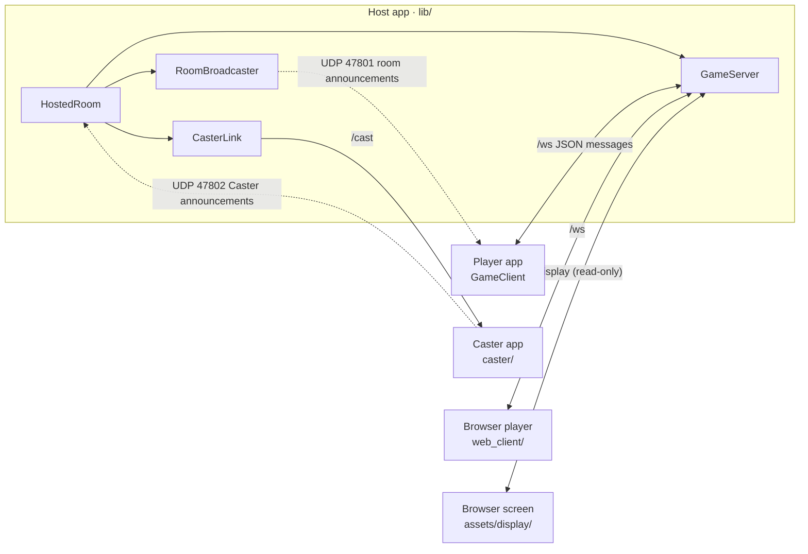

# Code map

A one-page orientation to the repository, so you can find the right files without reading everything.
`test/docs/code_map_test.dart` fails if a source file is missing here or a listed file no longer exists, so keep it
current when you add, move or delete files.

**Read next, depending on the task:** [ADDING_A_GAME.md](ADDING_A_GAME.md) to add a game; [PLAN.md](../PLAN.md)
for why things are the way they are; the [README](../README.md) for running, testing and the branch rules.

---

## 1. The big picture

- **The host is the referee.** `GameServer` owns the only `GameSession`. Clients send `action` messages and get back
  `viewFor(player)` (private). Shared screens get `tableView()` (public) inside `display` messages.
- **The host also plays,** through its own `GameClient` over loopback, identified by a secret `hostToken`. When the
  host's device *is* the shared screen, it takes no seat and receives `display` messages instead.
- **Packages:**
  - `nico_shared` is **web-safe** (no `dart:io`). It runs in the apps *and* the browser client.
  - `nico_native` is native-only LAN code (UDP).
  - The app, the Caster and the web client depend on them through `path:` dependencies.

---

## 2. Directory map

Lines are approximate, so you can tell big files from small ones.

### `lib/`: the host/join app (native only)

| File | Lines | What it does |
|---|---:|---|
| `lib/main.dart` | 29 | App entry and theme; opens `HomeScreen` |
| `lib/app/screen_awake.dart` | 25 | `ScreenAwake`: reference-counted wake lock while hosting |
| `lib/net/game_server.dart` | 670 | **`GameServer`**: HTTP + WebSocket server. Rooms, seats, nicknames, host-only commands, game sessions, display feed (`attachDisplay`, `DisplayHandle`), web routes (`/`, `/play/`, `/screen/`) |
| `lib/net/hosted_room.dart` | 165 | **`HostedRoom`**: everything a host runs. Starts the server and broadcaster, joins as host, loads web assets, keeps the screen awake, manages the Caster (`connectCaster`) |
| `lib/net/caster_link.dart` | 140 | `CasterLink`: outbound connection to a Caster (`castHello` handshake, attaches it as a display, drop notice) |
| `lib/net/web_files.dart` | 65 | `WebFiles`/`MemoryWebFiles`: static files in memory (from a zip or assets), content types |
| `lib/net/web_pages.dart` | 75 | Small generated HTML pages: landing page, "not included" pages |
| `lib/net/display_frontend.dart` | 20 | `DisplayFrontend` interface + `HtmlDisplayFrontend` (serves `/screen/`) |
| `lib/net/multicast_lock.dart` | 18 | Android Wi-Fi multicast lock via MethodChannel (no-op elsewhere) |
| `lib/screens/home_screen.dart` | 67 | Host / Join buttons |
| `lib/screens/host_setup_screen.dart` | 150 | Nickname, room name, game, Single game screen settings → `HostedRoom.create` → `SessionScreen` |
| `lib/screens/join_screen.dart` | 237 | Room scan list + manual IP; nickname retry loop; `parseManualAddress` |
| `lib/widgets/join_info.dart` | 111 | Host lobby card: addresses, `/screen` URL, `/play` QR code, Windows firewall hint |
| `lib/widgets/caster_picker.dart` | 165 | Host lobby "Choose screen": Casters found, manual address, connected Caster |
| `android/app/src/main/kotlin/com/daanjacobs97/nico_in_the_box/MainActivity.kt` | 50 | Android side of the multicast lock |

### `packages/nico_shared/`: shared by every app (web-safe)

| File | Lines | What it does |
|---|---:|---|
| `packages/nico_shared/lib/net/protocol.dart` | 305 | **The protocol**: ports, `kProtocolVersion`, `Msg.*` message types, `ErrorCode`, `PlayerInfo`, `LobbyState`, `DisplaySettings`, `DisplayInfo`, `DisplayState`, `CasterAnnouncement` |
| `packages/nico_shared/lib/net/game_client.dart` | 198 | **`GameClient`** (ChangeNotifier): connect + hello, lobby/game/display state, notices, host commands, `DisconnectReason` |
| `packages/nico_shared/lib/net/channel/connect.dart` | 3 | Picks the WebSocket implementation (conditional import) |
| `packages/nico_shared/lib/net/channel/connect_io.dart` | 6 | Native WebSocket with 5 s pings (the only `dart:io` allowed in this package) |
| `packages/nico_shared/lib/net/channel/connect_web.dart` | 3 | Browser WebSocket |
| `packages/nico_shared/lib/games/game_session.dart` | 54 | **`GameSession`** interface, `GameDefinition`, `GameActionException` |
| `packages/nico_shared/lib/games/registry.dart` | 14 | `availableGames`, `gameById` |
| `packages/nico_shared/lib/games/game_views.dart` | 45 | `GameViewContext` (+`compact`), `TableContext`, `gameViews` and `gameTables` maps |
| `packages/nico_shared/lib/games/tictactoe/tictactoe_game.dart` | 96 | Tic Tac Toe engine (marks swap per round) |
| `packages/nico_shared/lib/games/tictactoe/tictactoe_view.dart` | 170 | Tic Tac Toe player board + `TicTacToeTable` |
| `packages/nico_shared/lib/games/color_clash/clash_card.dart` | 80 | Cards, colors, `canPlayOn`, 108-card deck |
| `packages/nico_shared/lib/games/color_clash/color_clash_game.dart` | 324 | Color Clash engine (Uno-style rules, last-card catch, `custom` test constructor) |
| `packages/nico_shared/lib/games/color_clash/color_clash_view.dart` | 430 | Player view (full/compact), `ClashTableArea`, `ColorClashTable`, card widgets |
| `packages/nico_shared/lib/screens/session_screen.dart` | 254 | **`SessionScreen`**: lobby → game → result, notices, leaving, host-as-screen area |
| `packages/nico_shared/lib/screens/lobby_view.dart` | 209 | Lobby: game, players, Single game screen settings (host), pinned Start button |
| `packages/nico_shared/lib/screens/shared_screen_view.dart` | 138 | `SharedScreenView`: draws a `DisplayState` (lobby / table / result) |
| `packages/nico_shared/lib/widgets/display_settings_editor.dart` | 103 | Single game screen switch + "where is the screen" choice (`ScreenChoice`) |
| `packages/nico_shared/lib/widgets/host_controls.dart` | 134 | Host app-bar menu: restart, end, kick, close |
| `packages/nico_shared/lib/widgets/nickname_dialog.dart` | 66 | Nickname prompt with validation |
| `packages/nico_shared/lib/widgets/confirm_dialog.dart` | 27 | Yes/no dialog helper |
| `packages/nico_shared/lib/app/prefs.dart` | 21 | Remembered nickname (shared_preferences) |

### `packages/nico_native/`: native-only LAN code

| File | Lines | What it does |
|---|---:|---|
| `packages/nico_native/lib/discovery.dart` | 265 | Room announcements: `encodeAnnouncement`/`parseAnnouncement`, `RoomBroadcaster` (generic UDP announcer), `RoomScanner`, `localIPv4Addresses` |
| `packages/nico_native/lib/caster_scanner.dart` | 129 | `CasterScanner` + `DiscoveredCaster` (listens on UDP 47802) |

### `caster/`: Nico Caster app

| File | Lines | What it does |
|---|---:|---|
| `caster/lib/main.dart` | 149 | App: name (remembered), announcer, wakelock, landscape; shows `IdleScreen` or `SharedScreenView` |
| `caster/lib/cast_server.dart` | 135 | `CastServer`: `/cast` WebSocket, one host at a time (`casterBusy`), display updates |
| `caster/lib/idle_screen.dart` | 127 | "Waiting for a host", rename dialog, address |

### `web_client/`: browser player client (Flutter web)

| File | Lines | What it does |
|---|---:|---|
| `web_client/lib/main.dart` | 152 | Joins the host that served the page (`Uri.base`) and reuses `SessionScreen` |

### `assets/display/`: browser shared screen (`/screen/`, HTML/JS)

| File | Lines | What it does |
|---|---:|---|
| `assets/display/index.html` | 22 | Page shell; loads `app.js` and one script per game |
| `assets/display/app.js` | 133 | `NicoDisplay`: `/display` WebSocket, reconnect, lobby/result, safe `el()` DOM helper, `register()` |
| `assets/display/style.css` | 137 | TV-scaled styles |
| `assets/display/games/tictactoe.js` | 36 | Tic Tac Toe table renderer |
| `assets/display/games/colorclash.js` | 54 | Color Clash table renderer |

### `tool/`: scripts

| File | What it does |
|---|---|
| `tool/check.ps1`, `tool/check.sh` | **Run before every PR**: format check, analyze, all five test suites (`-Fix`/`--fix` formats first) |
| `tool/build_web_client.ps1`, `tool/build_web_client.sh` | Build `web_client/` into `assets/generated/web_client.zip` (git-ignored) |
| `tool/bot/lan_bot_test.dart` | Scripted LAN player: `flutter test tool/bot/lan_bot_test.dart --dart-define=HOST=<ip>` |

### `.github/`: CI and pull requests

| File | What it does |
|---|---|
| `.github/workflows/ci.yml` | CI on every PR: format, analyze, `dart:io` grep, all test suites, web client build + size budget, shared tests in Chrome |
| `.github/pull_request_template.md` | PR description sections: what and why, changes, checks, device tests |

---

## 3. Where to change what

| Task | Files |
|---|---|
| Add a game | [ADDING_A_GAME.md](ADDING_A_GAME.md) (engine + views in `packages/nico_shared/lib/games/<id>/`, `assets/display/games/<id>.js`, three registrations) |
| Change a game's rules | `packages/nico_shared/lib/games/<id>/<id>_game.dart` + its test |
| Add or change a network message | `protocol.dart` (`Msg`, bump `kProtocolVersion`) → `game_server.dart` (handle/send) → `game_client.dart` (receive/expose) |
| New host-only command | `protocol.dart` (`Msg`), `game_server.dart` (`hostCommands` + handler), `game_client.dart` (method), `host_controls.dart` or `lobby_view.dart` (button) |
| Lobby UI | `lobby_view.dart`; host-only native extras arrive through `hostFooter` / `hostScreenControls` from `host_setup_screen.dart` |
| Shared screen behaviour | server: `displayState`/`_broadcastDisplay` in `game_server.dart`; Flutter: `shared_screen_view.dart`; browser: `assets/display/app.js` |
| Room discovery | `nico_native/lib/discovery.dart` (+ `join_screen.dart` UI) |
| Caster protocol | `protocol.dart` (`kCast*`, `castHello`), `caster/lib/cast_server.dart`, `lib/net/caster_link.dart` |
| Web routes / served files | `_serveWeb` in `game_server.dart`, `web_files.dart`, `web_pages.dart` |
| What the host app bundles | `pubspec.yaml` `assets:` (`assets/generated/`, `assets/display/`) |

## 4. Protocol cheat sheet

| Port | Use |
|---|---|
| TCP 47800 | `/ws` players · `/display` screens (read-only) · `/` landing · `/play/` browser client · `/screen/` screen page |
| UDP 47801 | Room announcements (`nicobox`) |
| UDP 47802 | Caster announcements (`nicobox-caster`) |
| TCP 47803 | Caster `/cast` |

**Messages:** every message is JSON with a `type`.
- **Client → server:** `hello` (with `nickname`, `protocol`, optional `hostToken`, `client: app|web`) and `action`.
- **Host only:** `start`, `restart`, `endGame`, `kick`, `changeGame`, `closeRoom`, `setDisplay`.
- **Server → client:** `welcome`, `lobby`, `gameState`, `gameOver`, `notice`, `error`, `kicked`, `closed`, and
  `display` (to screens).
- **Host → Caster:** `castHello`, answered by `castWelcome` or `error{casterBusy}`.

## 5. Tests: what lives where

| Suite | Run from | Covers |
|---|---|---|
| `test/` (app) | repo root | server and client over real loopback sockets (`net/server_client_test.dart`), display feed (`net/display_feed_test.dart`), web routes (`net/web_routes_test.dart`), Caster link (`net/caster_link_test.dart`), hosted room (`net/hosted_room_test.dart`), home/dialog widgets (`widget_test.dart`), game registry (`games/registry_consistency_test.dart`), this map (`docs/code_map_test.dart`) |
| `packages/nico_shared/test/` | that folder | engines (`games/tictactoe_test.dart`, `games/color_clash_test.dart`, incl. privacy), protocol (`net/protocol_test.dart`), shared screens (`widgets/shared_screen_test.dart`). Also runs in Chrome in CI |
| `packages/nico_native/test/` | that folder | `discovery_test.dart`, `caster_scanner_test.dart` |
| `caster/test/` | that folder | `cast_server_test.dart`, `idle_screen_test.dart` |
| `web_client/test/` | that folder | `web_join_test.dart` |
| `integration_test/lan_play_test.dart` | repo root, on devices | Real app on two devices (options: `ROLE`, `SCREEN`, `GAMES`, `JOIN_IP`, `EXPECT_WEB_PLAYER`) |

## 6. Folders to skip

These are big, generated or irrelevant to most tasks. Don't read them unless the task is specifically about them:
- `android/`, `ios/`, `windows/` and the same folders under `caster/` and `web_client/` (Flutter platform scaffolding;
  the only hand-edited file is `MainActivity.kt` above, plus manifests and Info.plist for permissions)
- `build/`, `.dart_tool/`, `assets/generated/` (build output)
- `pubspec.lock` files (generated)
- `web_client/web/` (Flutter web shell: index.html, icons, manifest)

## 7. Gotchas

- **`packages/nico_shared` must not import `dart:io`**, because it runs in browsers. CI greps for this. A web build
  does *not* catch it (it only fails at runtime).
- **Bump `kProtocolVersion`** whenever a message shape changes or a game is added. Mismatched builds then refuse each
  other cleanly.
- **Rebuild the browser client** (`tool/build_web_client`) after changing `web_client/` or `nico_shared`. The host
  app serves its own copy.
- **Scale big screens with real sizes, not `Transform.scale`.** A transform paints bigger but lays out at the old size,
  so widgets overlap.
- **Wait on every client in tests.** Each client gets its own copy of an update, and they can arrive in any order.
- **Windows:** use `tool/check.ps1` instead of `dart format .`, which crashes on `caster/build`. Write commit
  messages to a file (`git commit -F`), because PowerShell 5.1 mangles quotes in `-m`. Keep the host test window
  visible during device tests.
